# Chainvoice System Architecture & Technical Design Document

This document provides a comprehensive technical reference for the architecture, system design, data structures, cryptographic mechanisms, security boundaries, and end-to-end operational workflows of the **Chainvoice** decentralized invoicing platform.

---

## Table of Contents

1. [Executive Summary & Core Principles](#1-executive-summary--core-principles)
2. [High-Level System Architecture](#2-high-level-system-architecture)
3. [Core Subsystems & Component Breakdown](#3-core-subsystems--component-breakdown)
   - 3.1 [Client Application & Wallet Integration](#31-client-application--wallet-integration)
   - 3.2 [Cryptographic Engine & Key Management](#32-cryptographic-engine--key-management)
   - 3.3 [Transport & Relay Subsystem (ThruBox Relay & Share Links)](#33-transport--relay-subsystem-thrubox-relay--share-links)
   - 3.4 [Smart Contract Protocol Layer (`Chainvoice.sol` v2)](#34-smart-contract-protocol-layer-chainvoicesol-v2)
4. [Data Architecture & Schema Specifications](#4-data-architecture--schema-specifications)
   - 4.1 [On-Chain State & Structs](#41-on-chain-state--structs)
   - 4.2 [Off-Chain Invoice Payload Schema](#42-off-chain-invoice-payload-schema)
   - 4.3 [Cryptographic Commitment & Hashing Model](#43-cryptographic-commitment--hashing-model)
5. [End-to-End System Workflows](#5-end-to-end-system-workflows)
   - 5.1 [Key Derivation & Public Key Registration Workflow](#51-key-derivation--public-key-registration-workflow)
   - 5.2 [Invoice Creation & Dispatch Workflow](#52-invoice-creation--dispatch-workflow)
   - 5.3 [Invoice Ingestion & Dual-Tier Verification Workflow](#53-invoice-ingestion--dual-tier-verification-workflow)
   - 5.4 [Settlement & Payment Execution Workflow](#54-settlement--payment-execution-workflow)
   - 5.5 [Invoice Cancellation Workflow](#55-invoice-cancellation-workflow)
   - 5.6 [Batch Operations Workflow](#56-batch-operations-workflow)
   - 5.7 [Protocol Treasury & Two-Step Governance Workflow](#57-protocol-treasury--two-step-governance-workflow)
6. [Security Model & Attack Mitigation Strategy](#6-security-model--attack-mitigation-strategy)
7. [Multi-Chain Network Strategy & Deployment Matrix](#7-multi-chain-network-strategy--deployment-matrix)

---

## 1. Executive Summary & Core Principles

Chainvoice is an open, trustless, non-custodial invoicing platform engineered for the Ethereum Virtual Machine (EVM) ecosystem. It combines an immutable, ownerless Solidity smart contract protocol with an end-to-end encrypted off-chain messaging and transport architecture.

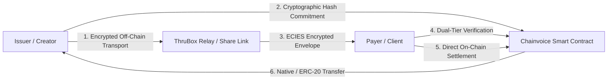

### Architectural Principles

1. **Minimalist On-Chain Footprint**: Confidential business details (line items, itemized rates, client names, taxes, personal notes) never touch the blockchain in plaintext. The contract stores only settlement parameters (`from`, `to`, `amountDue`, `tokenAddress`) and a 32-byte cryptographic commitment (`keccak256` digest).
2. **End-to-End Confidentiality (ECIES)**: Payloads exchanged across public relays are encrypted using Elliptic Curve Integrated Encryption Scheme (ECIES) over secp256k1 curves, readable solely by the intended recipient.
3. **Zero Hosted-Relay Wallet Connection**: Connects to browser wallets via standard EIP-6963 (WalletLink) without third-party centralized websocket bridges or mandatory project IDs.
4. **Ownerless & Non-Upgradeable Smart Contract**: The core contract logic has no admin proxy, no backdoor pause switches, and cannot be altered. Administrative control is limited to protocol fee adjustments and two-step fee receiver handover.
5. **Dual-Tier Zero-Trust Verification**: Resolving an invoice always cross-checks the decrypted off-chain payload against both the on-chain cryptographic hash and on-chain structural variables (addresses, amounts, token decimals).

---

## 2. High-Level System Architecture

The Chainvoice ecosystem is structured into four distinct, loosely coupled layers:

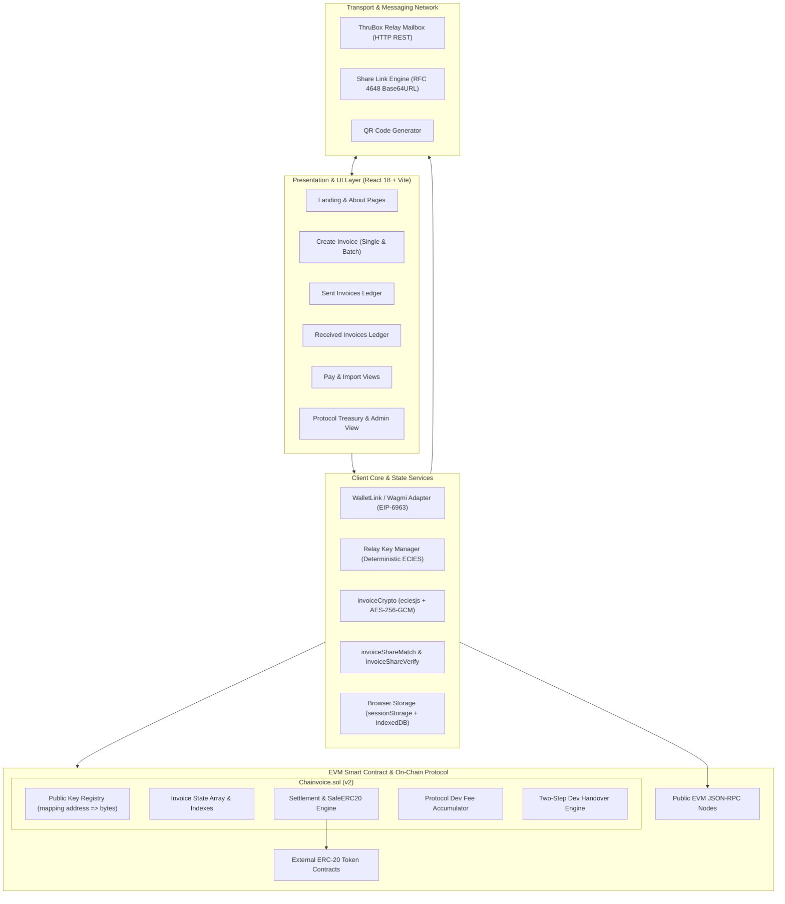

---

## 3. Core Subsystems & Component Breakdown

### 3.1 Client Application & Wallet Integration
- **Framework**: Built with React 18, Vite, Tailwind CSS, and Radix UI / shadcn/ui components.
- **Wallet Connection**: Implemented via `@stability-nexus/walletlink` adhering to **EIP-6963** (Multi-Injected Provider Discovery). Avoids vendor lock-in, centralized websocket relays, and external project keys.
- **RPC Communication**: Combines `viem` and `ethers` (v6). Read-only verification operates via lightweight, static `JsonRpcProvider` instances without requiring an active wallet session.

### 3.2 Cryptographic Engine & Key Management
- **Key Derivation Scheme**: Deterministic ECIES keypair generation derived directly from the user's Ethereum wallet via EIP-191 personal signatures.
- **Derivation Message**: Origin-bound and version-locked to prevent cross-site phishing:
  ```text
  ChainVoice Messaging Key Derivation v3

  Origin: https://chainvoice.stability.nexus
  Address: 0x...

  Signing this creates the key that decrypts your ChainVoice invoices.
  Only sign it on https://chainvoice.stability.nexus. Any other site asking for this signature can read your invoices.
  ```
- **Keypair Synthesis**:
  $$\text{PrivateKey} = \text{keccak256}(\text{walletSignature}) \quad (32\text{ bytes})$$
  $$\text{PublicKey} = \text{secp256k1\_uncompressed}(\text{PrivateKey}) \quad (65\text{ bytes, prefixed with } 0x04)$$
- **Encryption Scheme**: ECIES over secp256k1:
  - Ephemeral ECDH shared secret generation.
  - HKDF-SHA256 key derivation.
  - Authenticated symmetric payload encryption with AES-256-GCM.

### 3.3 Transport & Relay Subsystem (ThruBox Relay & Share Links)
Chainvoice provides two complementary data transport mechanisms:
1. **ThruBox Relay Network**:
   - A privacy-preserving, store-and-forward mailbox protocol (`@aossie-org/thrubox-client`).
   - Addresses are normalized to lowercase.
   - Payloads are encrypted client-side before transmission. The relay operates as an untrusted blind storage buffer.
   - Built-in rate-limiting protection with exponential backoff and `429 Too Many Requests` mitigation (`sendWithRateLimitRetry`).
2. **Self-Contained Share Links / QR Codes**:
   - Compresses the complete invoice payload into a URL-safe Base64URL string (RFC 4648 §5).
   - Allows permissionless sharing via email, chat, or paper QR codes without relay dependency.
   - Verifiable offline or via public RPC endpoints before the recipient ever connects a wallet.

### 3.4 Smart Contract Protocol Layer (`Chainvoice.sol` v2)
The smart contract operates on any EVM network with standard Solidity 0.8.19 semantics.

- **Non-Upgradeable**: Zero proxy contracts; logic is immutable.
- **Reentrancy Protection**: Explicit non-reentrant mutex locks protecting all payment and fee-withdrawal paths.
- **Safe Transfers**: Utilizes OpenZeppelin's `SafeERC20` with post-transfer balance validation to guard against fee-on-transfer shortfalls.
- **On-Chain Key Registry**: Transport-agnostic directory mapping EVM addresses to their 65-byte ECIES uncompressed public keys.

---

## 4. Data Architecture & Schema Specifications

### 4.1 On-Chain State & Structs

```solidity
struct InvoiceDetails {
    uint256 id;               // Sequential identifier (0-indexed)
    address from;             // Issuer / creditor wallet address
    address to;               // Payer / debtor wallet address
    uint256 amountDue;        // Settlement amount in token's base units (wei / atomic units)
    address tokenAddress;     // address(0) for native gas currency; contract address for ERC-20
    bool isPaid;              // Settlement flag (true once paid)
    bool isCancelled;         // Void flag (true if cancelled by issuer prior to payment)
    bytes32 invoiceDataHash;  // keccak256 digest of canonical off-chain payload JSON
}
```

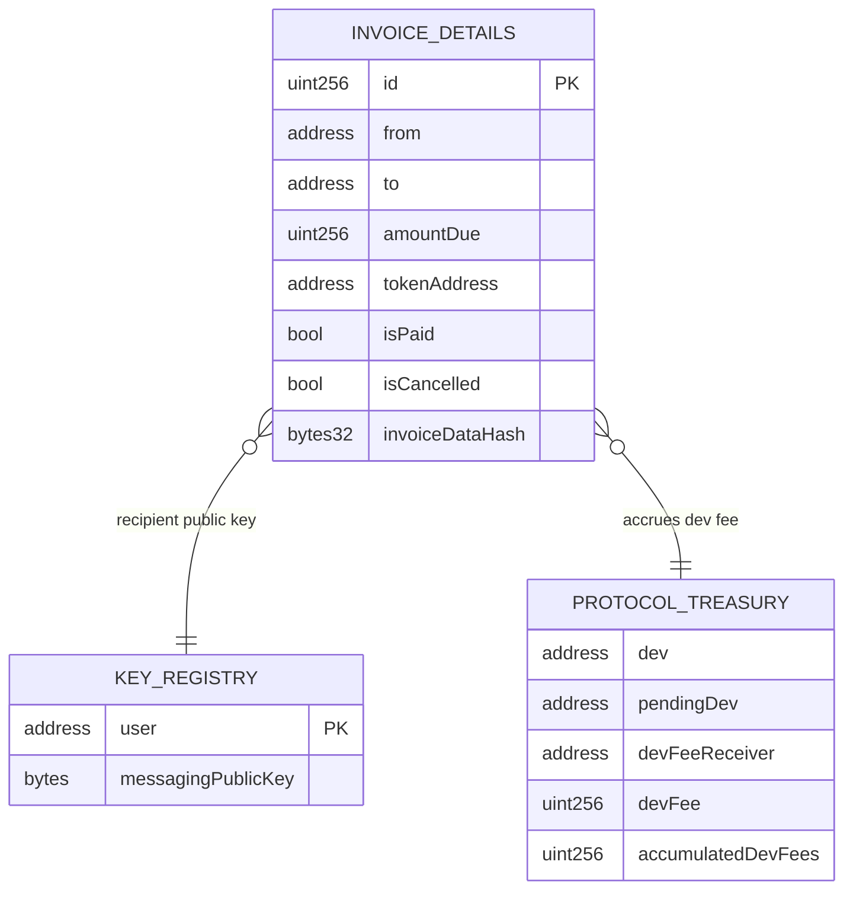

### 4.2 Off-Chain Invoice Payload Schema

The rich invoice payload structure validated by `invoicePayloadShape.js`:

```json
{
  "user": {
    "address": "0x1234...abcd",
    "fname": "Alice",
    "lname": "Smith",
    "email": "alice@example.com",
    "country": "USA",
    "city": "San Francisco",
    "postalcode": "94107"
  },
  "client": {
    "address": "0x5678...ef01",
    "fname": "Bob",
    "lname": "Jones",
    "email": "bob@example.com",
    "country": "UK",
    "city": "London",
    "postalcode": "EC1A 1BB"
  },
  "items": [
    {
      "description": "Smart Contract Security Audit",
      "quantity": 1,
      "rate": 2500,
      "tax": 0,
      "taxType": "percentage",
      "discount": 0,
      "discountType": "percentage",
      "amount": 2500
    }
  ],
  "paymentToken": {
    "address": "0x0000000000000000000000000000000000000000",
    "symbol": "ETH",
    "name": "Ether",
    "decimals": 18
  },
  "amountDue": "2500",
  "issueDate": "2026-11-26T10:00:00.000Z",
  "dueDate": "2026-12-10T10:00:00.000Z",
  "notes": "Payment due within 14 days",
  "batchInfo": {
    "batchId": "batch_987654",
    "batchType": "vendor_payout",
    "batchSize": 1,
    "index": 0
  }
}
```

### 4.3 Cryptographic Commitment & Hashing Model

The link between off-chain confidentiality and on-chain enforcement is the 32-byte hash commitment:

$$\text{invoiceDataHash} = \text{keccak256}(\text{toUtf8Bytes}(\text{canonicalJsonString}))$$

When storing or verifying:
1. All keys in JSON payload are canonically ordered.
2. BigInt/Numeric fields are stringified deterministically.
3. The contract asserts `invoiceDataHash != bytes32(0)`.
4. Anyone modifying even 1 bit of off-chain metadata causes verification to abort immediately.

---

## 5. End-to-End System Workflows

### 5.1 Key Derivation & Public Key Registration Workflow

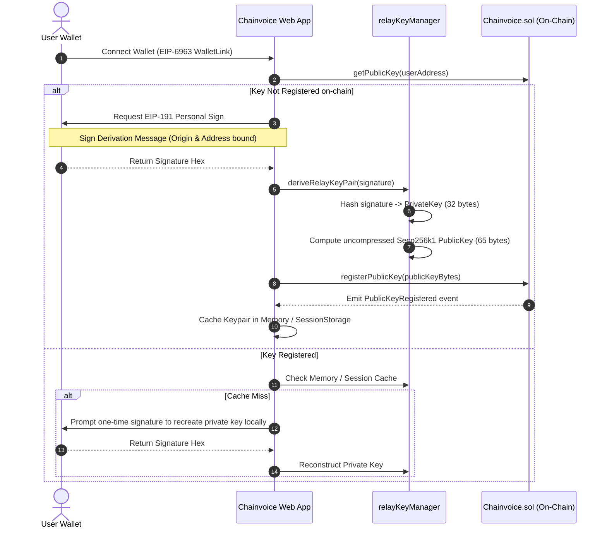

---

### 5.2 Invoice Creation & Dispatch Workflow

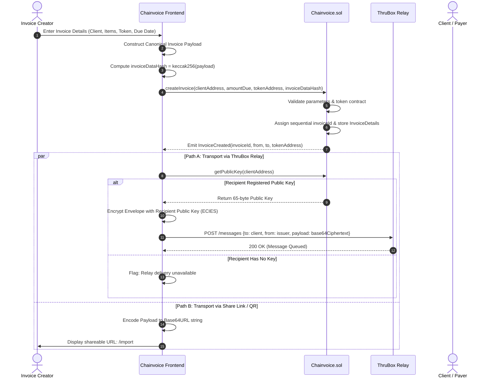

---

### 5.3 Invoice Ingestion & Dual-Tier Verification Workflow

When an invoice arrives via Relay or Share Link, the client enforces strict dual-tier validation before permitting payment.

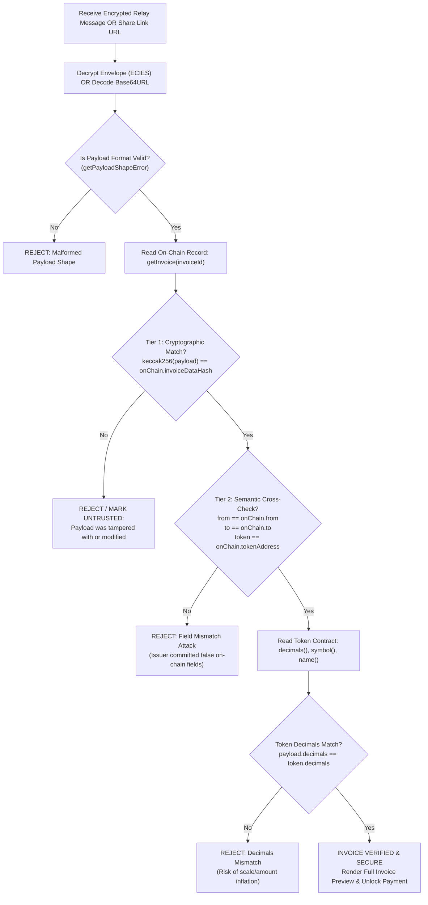

---

### 5.4 Settlement & Payment Execution Workflow

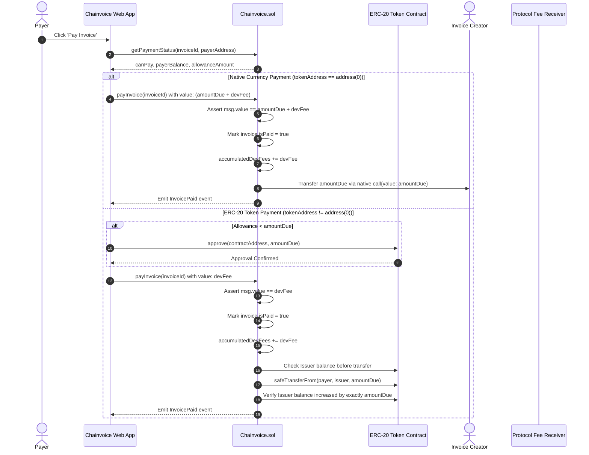

---

### 5.5 Invoice Cancellation Workflow

Invoices can be revoked by the creator before payment occurs:

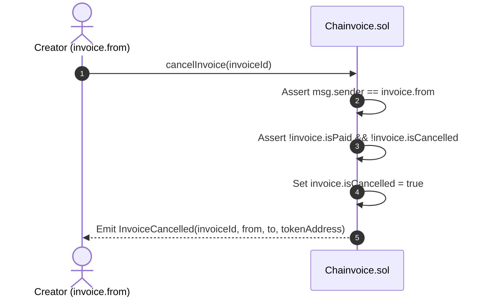

---

### 5.6 Batch Operations Workflow

Chainvoice supports atomic batch creation and batch settlement to reduce transaction overhead:

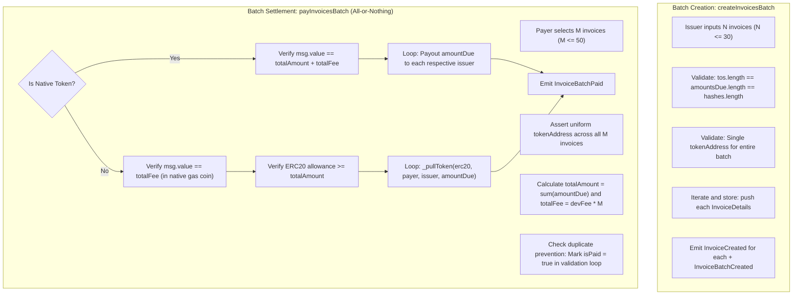

---

### 5.7 Protocol Treasury & Two-Step Governance Workflow

The contract features a decentralized, ownerless protocol fee mechanism with a secure two-step handover.

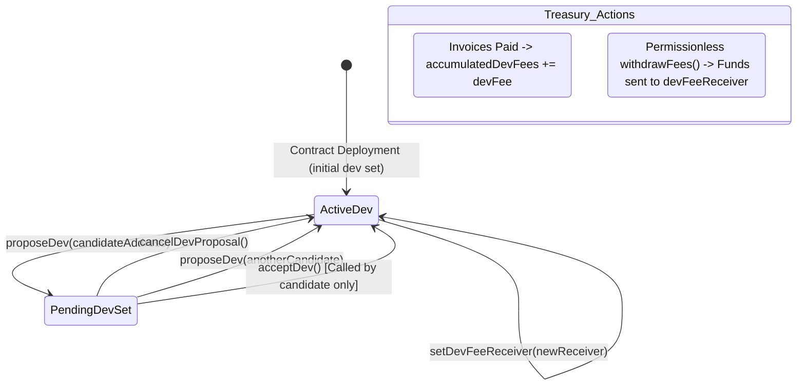

---

## 6. Security Model & Attack Mitigation Strategy

| Threat Vector | Attack Scenario | Chainvoice Mitigation Architecture |
| :--- | :--- | :--- |
| **Reentrancy** | Malicious contracts intercepting payouts to re-enter `payInvoice` or `withdrawFees`. | Explicit `nonReentrant` modifier on all state-modifying payable methods; strict Checks-Effects-Interactions (CEI) order. |
| **Fee-On-Transfer Token Shortfall** | Token charges transfer tax, leaving issuer underpaid while invoice is recorded as fully paid. | `_pullToken` checks payee balance delta (`afterBal - before < amount`) and reverts if tokens were burned/taxed. |
| **Return-Value Incompatibilities** | Non-standard ERC-20s (e.g., USDT) that do not return a boolean on `transferFrom`. | Uses OpenZeppelin `SafeERC20` wrapper to safely handle missing return values. |
| **Phishing / Key Impersonation** | Malicious websites tricking users into signing messages to steal invoice decryption keys. | Key derivation signature is strictly bound to `origin` and `address` with versioning (`v3`). An attacker cannot reuse signatures from another domain. |
| **Deceptive Hash Commitment** | Hostile creator commits a hash of one payload but specifies a higher amount or different recipient on-chain. | **Dual-Tier Verification**: `evaluateOnChainInvoice` independently validates `from`, `to`, `tokenAddress`, and `amountDue` against on-chain values. |
| **Decimals Manipulation** | Off-chain payload lies about token decimals to display a misleading fiat value. | Decimals are fetched directly on-chain from the ERC-20 contract (`contract.decimals()`) using a verified provider, never trusted from the payload. |
| **Block Gas Exhaustion (DOS)** | Infinite loops or unbounded arrays in contract calls. | Strict hardcoded bounds: `MAX_BATCH = 50`, `MAX_CREATE_BATCH = 30`, and paginated read views with `MAX_PAGE_LIMIT = 50`. |
| **Administrative Takeover** | Compromised admin instantly redirecting protocol fees. | No contract owner exists. The `dev` role can only adjust fees and requires a two-step handover (`proposeDev` $\to$ `acceptDev`). Fee withdrawals are hardcoded to `devFeeReceiver`. |

---

## 7. Multi-Chain Network Strategy & Deployment Matrix

Chainvoice is blockchain-agnostic and functions on any EVM network with standard JSON-RPC capabilities.

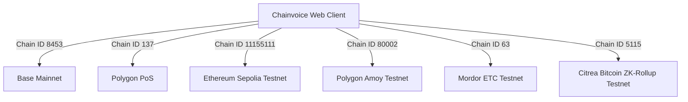

### Protocol v2 Deployment Addresses

| Network | Chain ID | Environment Key | Deployed Address | Role |
| :--- | :---: | :--- | :--- | :--- |
| **Base** | `8453` | `VITE_CONTRACT_ADDRESS_8453` | `0x9b31091AA0b4F287114B2A9a3D239Db04a9A07E1` | Production Mainnet |
| **Polygon PoS** | `137` | `VITE_CONTRACT_ADDRESS_137` | `0x9b31091AA0b4F287114B2A9a3D239Db04a9A07E1` | Production Mainnet |
| **Ethereum Sepolia** | `11155111` | `VITE_CONTRACT_ADDRESS_11155111` | `0x6E5Ac5C2c10b4eD34909CFf0DF776832504E9677` | EVM Testnet |
| **Polygon Amoy** | `80002` | `VITE_CONTRACT_ADDRESS_80002` | `0xBee456a4eF315273E9b6bC1C9eE0737aefD461e0` | EVM Testnet |
| **Mordor Testnet** | `63` | `VITE_CONTRACT_ADDRESS_63` | `0x9b306924Eef2f021E1BC8a54202E90057E3988d8` | ETC Testnet |

---

*Document compiled directly from repository source code analysis of `contracts/src/Chainvoice.sol`, `frontend/src/services/relay/`, and `frontend/src/utils/`.*
