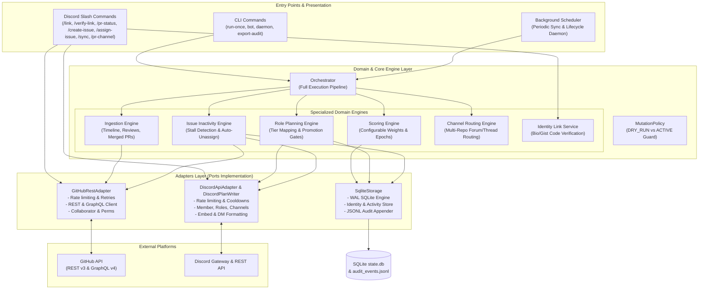
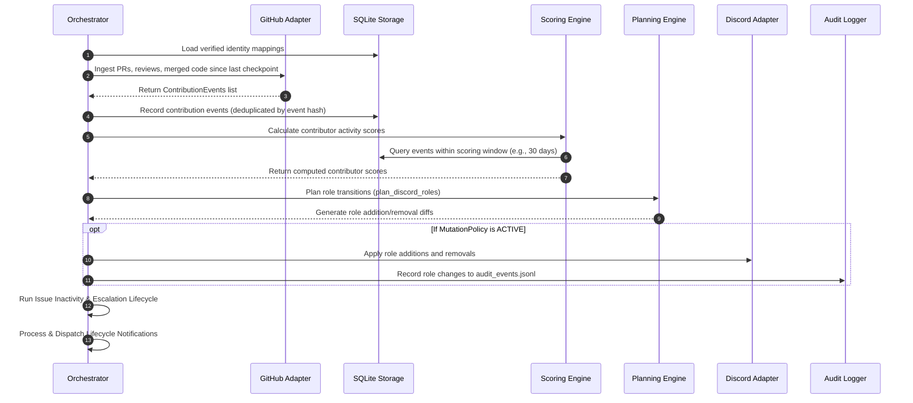
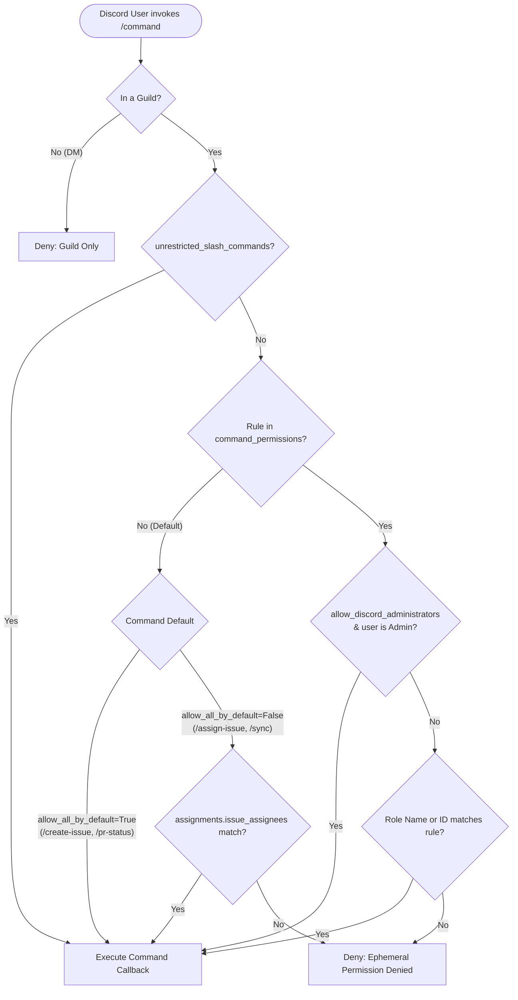
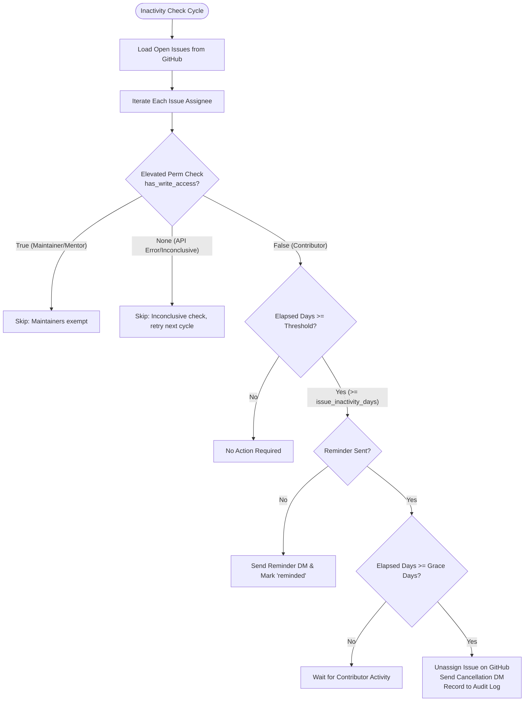

# Gitcord: Complete System Architecture & Engineering Reference

Gitcord is a local-first, audit-first synchronization and automation engine connecting GitHub organizations to Discord developer communities. It automates contributor onboarding, GitHub-to-Discord identity verification, activity ingestion, scoring, Discord role progression, notifications, and issue lifecycle tracking.

---

## 1. High-Level Architectural Principles

Gitcord is built upon four foundational software engineering principles:

1. **Hexagonal Architecture (Ports and Adapters)**:
   The core domain logic (scoring, role planning, inactivity detection, routing) is decoupled from external platforms through Python `typing.Protocol` interfaces (`GitHubReader`, `GitHubWriter`, `DiscordReader`, `DiscordWriter`, `Storage`). Adapters for GitHub, Discord, and SQLite can be swapped without changing core business logic.

2. **Audit-First & Fail-Safe Execution**:
   Every state-altering event (identity link, issue assignment, issue creation, role assignment, unassignment) is atomically committed to SQLite and appended to an append-only, line-delimited JSON audit file (`audit_events.jsonl`).

3. **Strict Mutation Policy**:
   Operations are gated by a runtime `MutationPolicy` supporting `DRY_RUN` (log and plan without modifying GitHub or Discord) and `ACTIVE` (execute platform mutations). Granular flags (`github_write_allowed`, `discord_write_allowed`) guard all external writes.

4. **Local-First & Zero External Dependencies**:
   State is retained in a local, single-file SQLite database (`state.db`) requiring no hosted database services, message queues, or third-party backend servers.

---

## 2. System Architecture Diagram



---

## 3. Core Architectural Layers

### 3.1. Entry Points & Invocation Modes
Gitcord supports three execution models:
- **CLI One-Shot (`ghdcbot run-once`)**: Runs a single batch execution of the synchronization, scoring, role adjustment, and notification pipeline, then terminates.
- **Daemon (`ghdcbot daemon`)**: Runs scheduled periodic sync cycles based on cron-like intervals.
- **Discord Bot Daemon (`ghdcbot bot`)**: Connects to the Discord Gateway, registers application slash commands (`CommandTree`), handles interactive button views (`IdentityVerificationView`, `PRStatusView`, `IssueAssignmentView`), and listens to passive channel PR previews.

### 3.2. Core Protocols (`src/ghdcbot/core/interfaces.py`)
Decoupling is guaranteed through five protocol definitions:
- `GitHubReader`: Methods to read repositories, open issues, pull requests, reviews, comments, and check repository collaborator permissions (`has_write_access`, `check_user_permission`).
- `GitHubWriter`: Methods to mutate GitHub resources (`create_issue`, `assign_issue`, `unassign_issue`, `add_issue_comment`).
- `DiscordReader`: Methods to inspect guild members, guild roles, and fetch channel message history.
- `DiscordWriter`: Methods to modify Discord states (`assign_roles`, `remove_roles`, `send_channel_message`, `send_dm`).
- `Storage`: Methods to store and query identity mappings, contribution counters, activity timestamps, issue trackers, channel routes, and write to `audit_events.jsonl`.

---

## 4. End-to-End Data Pipelines

### 4.1. Orchestration & Sync Pipeline (`run-once`)



#### Detailed Steps:
1. **Checkpoint Retrieval**: Queries `state.db` for the last processed event timestamp to minimize GitHub API calls.
2. **Event Ingestion**: Fetches pull request creations, merges, review comments, and approval threads. Reverts are detected by scanning PR revert references.
3. **Identity Resolution**: Maps GitHub logins to Discord user IDs via verified identity claims.
4. **Scoring**: Computes weighted scores based on configured metrics (`weights: {pr_merged: 5, issue_opened: 1, pr_reviewed: 3}`).
5. **Role Planning**: Compares current Discord guild member roles against target score tiers. Promotion-only rules (`merge_role_rules`) prevent contributors from losing earned milestone roles.
6. **Execution & Audit**: Applies changes via `DiscordPlanWriter` under `MutationPolicy` guard.

---

### 4.2. Slash Command Authorization & Execution Pipeline



#### Detailed Steps:
1. **Interaction Interception**: Invocation hits `app_commands.CommandTree`.
2. **Access Control Check (`slash_command_allowed`)**:
   - Rejects non-guild user interactions.
   - Evaluates `discord.command_permissions[<command_name>]`.
   - Commands like `/create-issue` and `/pr-status` default to open access (`allow_all_by_default=True`) unless explicitly restricted by an admin rule.
   - Commands like `/assign-issue` and `/sync` fall back to legacy `assignments.issue_assignees` if omitted.
3. **Execution & Information Leak Prevention**: Unauthorized users receive immediate ephemeral error messages before `interaction.response.defer()`, avoiding information leakage.

---

### 4.3. Issue Inactivity & Escalation Lifecycle Pipeline



#### Detailed Steps:
1. **Tracker Synchronization**: Active issue assignments tracked in `issue_assignments` table are cross-checked against GitHub's live issue states.
2. **Privilege Gating (`has_write_access`)**: Queries `/repos/{owner}/{repo}/collaborators/{username}/permission`. Maintainers, admins, and write-access users are skipped. Inconclusive queries (`None`) skip without state changes or caching.
3. **Activity Probe**: Inspects contributor commits, PR references, and issue comments. If recent activity exists, the inactivity timer resets.
4. **Reminder DM**: Once the inactivity threshold is exceeded, a personalized DM is sent to the verified Discord user.
5. **Escalation & Unassignment**: If the grace period expires without activity, Gitcord unassigns the contributor on GitHub, posts an explanatory comment, and records the event in `audit_events.jsonl`.

---

## 5. Persistence & Storage Architecture

```
<data_dir>/
├── state.db                     # Primary SQLite database (WAL mode enabled)
│   ├── verified_identities       # Discord ID <-> GitHub login mappings
│   ├── contribution_events       # Processed GitHub lifecycle events
│   ├── issue_assignments         # Live assignment timestamps and tracking
│   ├── issue_inactivity_records  # Inactivity status ('active', 'reminded', 'unassigned')
│   ├── repo_channel_routes       # Discord channel routing overrides
│   ├── social_profiles           # Contributor X/LinkedIn profile handles
│   └── user_metrics              # Pre-aggregated scoring cache
└── audit_events.jsonl           # Append-only chronological JSON audit trail
```

---

## 6. Directory Structure & Key Code Modules

```
src/ghdcbot/
├── adapters/                    # External platform integration
│   ├── discord/                 # Discord API adapter, plan writer, rate limiters
│   ├── github/                  # REST & GraphQL adapters, auth, pagination
│   └── storage/                 # SQLite storage engine & schema migrations
├── config/                      # Configuration models, Pydantic schemas, YAML parser
├── core/                        # Abstract protocols, domain interfaces, data models
├── engine/                      # Business logic
│   ├── audit_export.py          # Audit trail queries and filters
│   ├── channel_routes.py        # Multi-repo channel routing
│   ├── inactivity.py            # Issue stall tracking & reminder lifecycle
│   ├── issue_assignment.py      # Assignment views & validation
│   ├── issue_creation.py        # Issue creation views & payload formatting
│   ├── notifications.py         # Discord webhook and direct message dispatchers
│   ├── orchestrator.py          # Primary end-to-end execution pipeline
│   ├── planning.py              # Role calculation & promotion/demotion diffs
│   └── scoring.py               # Contributor score aggregation algorithms
├── bot.py                       # Discord bot runner, slash commands, autocomplete
└── discord_command_permissions.py # Slash command authorization engine
```
